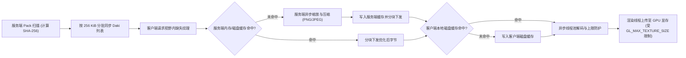

# 联机部署与常见问题（FAQ）

_[English](./Multiplayer-And-FAQ.md) | [返回 Wiki 首页](./Home-zh.md)_

---

## 1. 独立服务端部署步骤

1. **安装匹配的 Mod JAR**：确保服务端与所有客户端安装相同 Minecraft 版本与相同 Loader 的 JAR（Fabric 端和客户端均需安装 Fabric API）。
2. **仅在服务端放置抱枕包**：将自定义文件夹包或 `.zip` 包放入服务端的 `<serverDir>/dakimakura-mod/`。**玩家客户端不需要提前下载这些抱枕包。**
3. **启动或热重载**：首次启动会自动释放示例包并生成 `config/dakimakuramod-common.toml`；后续增删抱枕包只需在控制台或由 OP 执行 `/dakimakura reload`。

---

## 2. 纹理优化、缓存与联机传输架构

为了避免大量高分辨率抱枕导致进服卡顿、数据包超限断连或显存溢出，本分支对传输链路做了全流程优化：

- **列表分批同步**：即使服务器安装了上千款抱枕，登录时的抱枕列表也会按 **256 KiB** 分批发送，避免触发原版 1 MiB S2C 数据包上限导致玩家被踢出。
- **零渲染线程磁盘 I/O**：客户端磁盘缓存读取、图片解码与缩放均在受控的后台守护线程池中完成，避免进服或转头瞬间卡死游戏主线程。
- **内容哈希去重**：所有缓存均以（图片字节 + `smooth` + 服务端压缩参数）的 SHA-256 作为索引，修改服务端压缩参数或替换图片会自动使旧缓存失效。

---

## 3. 服务端性能调优预设

所有服务端参数位于 `<serverDir>/config/dakimakuramod-common.toml`（完整说明见 [配置项参考](./Configuration-zh.md)）：

| 预设场景 | `maxTransferHeight` | `jpegQuality` | `memoryCacheMinutes` | `diskCacheEnabled` | `diskCacheMegabytes` |
|---|---|---|---|---|---|
| **默认均衡（推荐）** | `1536` | `0.80` | `10` | `true` | `1024` |
| **低带宽 / 小水管服务器** | `1024`（或 `768`） | `0.70` | `15` | `true` | `1024` |
| **高画质 / 大内存专用服** | `2048` | `0.85` | `30` | `true` | `2048`（或 `0` 不限） |

客户端显存紧张时，可在 `<gameDir>/config/dakimakuramod-client.toml` 中将 `memoryCacheMinutes` 调低至 `5 ~ 10`（默认 `20`）。

---

## 4. 常见问题排查（FAQ）

### Q1：玩家进服后抱枕显示为紫黑块或缺失纹理？
- 检查源图文件是否超过了 `maxSourceMegabytes`（默认 `32 MB`），或者图片分辨率超过 `32768` / `256M` 像素限制——超限图片会被服务端安全阀跳过并在日志中报错。
- 确认抱枕目录内确实存在 `front.*` / `back.*`，或 `daki-info.json` 中指定的 `"image-front"` / `"image-back"` 文件名大小写与实际文件完全一致（Linux 服务端区分大小写）。

### Q2：添加新抱枕包后游戏里没有显示？
- 确认目录结构正确：文件夹包应为 `dakimakura-mod/<包名>/<抱枕名>/front.png`（不要多套或少套目录）。
- 在游戏中执行 `/dakimakura reload`（需 OP 权限），并检查服务端日志是否有加载提示或 JSON 解析报错。

### Q3：像素风抱枕在游戏里变糊了？
- 像素画请在 `daki-info.json` 中显式设置 `"smooth": false`，这样服务端会保留邻近插值的锐利像素边缘并使用无损 PNG 传输。

### Q4：为什么不能把 Forge 版和 NeoForge / Fabric 版混装？
- 不同 Loader 的网络通道、注册表与事件 API 完全不同。服务端与客户端必须使用同一 Loader、同一 Minecraft 版本的 JAR；Fabric 还必须额外安装对应版本的 Fabric API。

### Q5：可以删除缓存目录吗？
- 可以。`<gameDir>/dakimakura-mod-server-cache/`（服务端缓存）与 `<gameDir>/dakimakura-mod-cache/`（客户端缓存）随时可以安全删除，之后会按需自动重建。但请勿误删存放原图的 `<gameDir>/dakimakura-mod/`。
