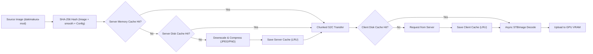

# Multiplayer & FAQ

[Back to Wiki Home](./Home.md) | _[中文版本](./Multiplayer-And-FAQ-zh.md)_

---

## Dedicated Server Setup

1. Install the matching Minecraft + mod loader JAR on both the server and every connecting client (plus **Fabric API** on Fabric).
2. Place your custom packs (folders or `.zip` files) into `<serverDir>/dakimakura-mod/`. **Clients do not need to install custom packs manually.**
3. Start the server, or run `/dakimakura reload` after adding new packs while the server is running.
4. On login (and on reload), the server sends the pack metadata list to clients in **256 KiB batches**, and streams individual textures on demand.

---

## Texture Optimization, Cache & Transfer Pipeline

---

## Performance Tuning Presets

Edit `<gameDir>/config/dakimakuramod-common.toml` (server) and `dakimakuramod-client.toml` (client) — see [Configuration Reference](./Configuration.md) for all options.

| Preset | `maxTransferHeight` | `jpegQuality` | Server `memoryCacheMinutes` | Client `memoryCacheMinutes` | Best For |
|---|---|---|---|---|---|
| **Low-Bandwidth / Small VPS** | `1024` (or `768`) | `0.70` | `5` | `10` | Constrained upload bandwidth, tight RAM/VRAM, or many players joining simultaneously. |
| **Balanced (Default)** | `1536` | `0.80` | `10` | `20` | Most servers and singleplayer worlds; crisp in-game look with ~90% smaller transfers than raw 4K art. |
| **High-Res / LAN** | `2048` (or `3072`) | `0.90` | `30` | `60` | Local networks or dedicated servers with plenty of bandwidth, RAM, and GPU VRAM. |

---

## Troubleshooting FAQ

### A dakimakura renders as a missing (purple/black) texture
- Check the server log for warnings. Common causes:
  - The source image exceeds `maxSourceMegabytes` (default `32 MB`), `32768` px dimension, or `256M` pixels.
  - The filename in `daki-info.json` (`image-front` / `image-back`) does not match the actual file in the folder/zip (check case sensitivity on Linux servers!).
  - The image file is corrupted or in an unsupported format (use `.png`, `.jpg`, or `.jpeg`).

### Players see blank white pillows for a few seconds on first join
- This is normal when textures are not yet in the client's `<gameDir>/dakimakura-mod-cache/`. The server optimizes and streams textures on demand, and the client caches them on disk so subsequent logins are instant.

### My pixel-art dakimakura looks blurry
- Add `"smooth": false` to that dakimakura's `daki-info.json`. By default, `"smooth"` is `true` (bicubic scaling + JPEG), which softens sharp pixel edges.

### I edited `dakimakuramod-common.toml` on Fabric, why didn't it apply?
- On Forge and NeoForge, the in-game Config UI reloads settings automatically. On Fabric, edit the TOML file and run `/dakimakura reload` (requires OP / cheats) to apply changes.

### Can I delete the cache folders safely?
- Yes. Both `<gameDir>/dakimakura-mod-server-cache/` and `<gameDir>/dakimakura-mod-cache/` are safe to delete at any time; they will refill automatically as textures are requested.
